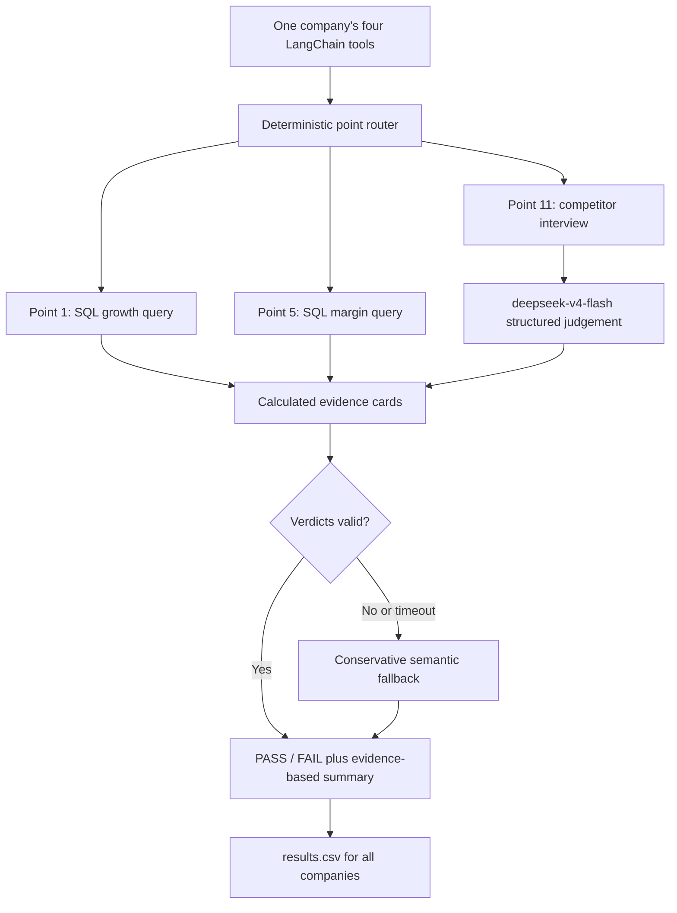

# FTEC5660 Homework 3: Fisher's 15-Point Investment Agent

Build a LangChain agent that researches a company with tools and applies the
framework from Philip Fisher's *Common Stocks and Uncommon Profits* (Part One,
Chapter 3 "What to buy: the fifteen points to look for in a common stock", and
Chapter 4 "What to buy: applying this to your own needs"). You choose 3 of
Fisher's 15 points and decide yourself what PASS means for each. For every
company your agent gives a PASS/FAIL verdict on your 3 points and a short
summary.

The companies are fictional, so the model cannot answer from memory. Unlike a
pile of reports, the evidence is spread over three sources, and your agent has
to go and get it with tools, the way Fisher's "scuttlebutt" method sends an
investor to talk to customers, competitors, suppliers and staff.

## Data and tools

`public_test/` has one folder per company. Your code receives four tools per
company (built by the provided code in `hw3.py`):

| Tool | What it gives you |
| --- | --- |
| `list_documents()` | the company's six documents and their dates |
| `read_document(name)` | one document: the 2025 letter to shareholders, four earnings calls (Q3 2025 to Q2 2026) and a news file (July 2025 to July 2026) |
| `sql_query(query)` | one read-only SQLite query on the company's database; at most 50 rows come back, so use `SUM`, `GROUP BY` and `WHERE` |
| `interview(role, topic)` | what one person says about the company; at most **10 interviews per company** |

The documents are what management says. Management's own claims (such as "we
have never cut research" or "our people are our greatest strength") are not
evidence on their own: check them against the database and the interviews.

**Database tables** (amounts in USD thousands; dates `YYYY-MM-DD`, months
`YYYY-MM`, quarters like `2025Q3`; the fiscal year is the calendar year):

| Table | Columns |
| --- | --- |
| `company` | name, industry |
| `industry_medians` | industry, revenue_growth_2y_pct, new_product_share_pct, new_product_sales_per_rd, operating_margin_pct (one row per industry; use the row for the company's own industry) |
| `orders` | order_id, order_date, product, customer, amount, note (about 3,000 to 4,000 orders from January 2023 to June 2026; revenue is the sum of order amounts) |
| `products` | product, launch_date |
| `monthly_costs` | month, cost_of_sales, selling_admin, research_development |
| `quarterly_cash` | quarter, operating_cash_flow, capex, cash_end |
| `capex_plan` | year, planned_capex (2026 to 2028) |
| `returns` | month, units_shipped, units_returned |
| `insider_trades` | trade_date, person, title, side (`buy` or `sell`), shares, price |

**Terms used in the data.**

| Term | Meaning |
| --- | --- |
| FY2025 | Fiscal year 2025. Here the fiscal year is the calendar year, so FY2025 is January to December 2025. |
| Quarter | Three months of the year: Q1 is January to March, Q2 April to June, Q3 July to September and Q4 October to December. The database writes `2025Q3`; the documents write "third quarter 2025". |
| Amounts | The database is in **USD thousands** (676,100 means US$676.1 million). The documents use USD millions. |
| Revenue | Money from sales: the sum of `amount` in `orders`. |
| Cost of sales | The cost of making the products that were sold. |
| Selling and admin | The cost of selling and of running the company (sales staff, offices, management). |
| R&D | Research and development spending, mainly on new products. |
| Operating margin | Operating profit as a share of revenue: (revenue − cost of sales − selling and admin − R&D) ÷ revenue. |
| Operating cash flow | Cash that the day-to-day business brings in during a quarter. |
| Cash at the end of a quarter | The cash the company holds on the last day of that quarter (`cash_end`). |
| Capex | Capital expenditure: spending on factories, machines and other long-term assets. `capex_plan` holds the planned capex for 2026 to 2028. |
| Return rate | Units returned ÷ units shipped, from the `returns` table. |
| Industry median | The middle value for companies in the same industry, from `industry_medians`. |
| Insider | A director or senior manager of the company. `insider_trades` lists the shares they bought (`buy`) or sold (`sell`). |
| Earnings call | A meeting each quarter where management presents the quarter's results to investors. Each call quotes that quarter's revenue. |

**Interviews.** Roles: `customer`, `current_employee`, `former_employee`,
`competitor`, `supplier`. Topics: `sales_team`, `working_conditions`,
`top_management`, `decision_making`, `competitive_edge`. Only some people know
about each topic; the others say they can't comment, and that answer still
uses up one interview.

| Topic | Who knows about it |
| --- | --- |
| `sales_team` | customer, competitor |
| `working_conditions` | current_employee, former_employee |
| `top_management` | former_employee, supplier |
| `decision_making` | supplier, customer |
| `competitive_edge` | competitor, customer |

People who know about a topic always agree with each other, so one good answer
is enough.

## Choose your 3 points and your rules

Pick any 3 of Fisher's 15 points and write them in `CHOSEN_POINTS` near the
top of `hw3.py`, e.g. `CHOSEN_POINTS = [1, 7, 15]`. The full questions are in
`FISHER_POINTS` in `hw3.py` and in the book.

| # | Fisher's point | Where the evidence is |
| --- | --- | --- |
| 1 | Market potential for sales growth | database |
| 2 | New products as current lines mature | database |
| 3 | Effective research and development | database |
| 4 | Above-average sales organization | interviews (`sales_team`) |
| 5 | Worthwhile profit margin | database |
| 6 | Maintaining or improving margins | database |
| 7 | Labour and personnel relations | interviews (`working_conditions`) |
| 8 | Executive relations | interviews (`top_management`) |
| 9 | Depth of management | interviews (`decision_making`) |
| 10 | Cost analysis and accounting controls | earnings calls, checked against the database |
| 11 | Advantage over competitors | interviews (`competitive_edge`) |
| 12 | Long-range outlook on profits | database |
| 13 | Growth without dilutive equity financing | database |
| 14 | Management talks freely about troubles | earnings calls, checked against the database |
| 15 | Management of unquestionable integrity | news file, checked against the database |

For each of your points, **you design the rule**: which evidence to use, what
to compute or whom to ask, and where the line between PASS and FAIL lies. PASS
means the company looks favourable on that point, as Fisher would see it.

We grade your verdicts against our own answer key. It uses one fixed rule per
point, which we do not publish, and the data never puts a company close to
the line of that rule, so a sensible reading of Fisher usually gives the same
answer. **Test your rules on the public answers**:
`public_test/ground_truth.json` gives the expected verdict on all 15 points
for each of the 20 public companies, and every point fails in 6 of them. If
your rule disagrees with the public answers, rethink it.

**Tip: calculate with tools, not in your head.** Do every sum, ratio and
comparison in SQL or Python, including the number of days between two dates
(SQLite's `julianday()` gives a date as a number of days).

## Student task

Fill in the three places in `hw3.py` marked `### YOUR CODE HERE`. You may add
imports, constants and helper functions above them, but do not change the
provided code below them:

- `CHOSEN_POINTS` lists your 3 points.
- `build_agent()` creates your model and anything else you need once.
- `analyze_companies(agent, companies)` receives
  `{company_folder: [list_documents, read_document, sql_query, interview]}`
  and returns, for every company,
  `{"points": {1: "PASS", 7: "FAIL", 15: "PASS"}, "summary": "..."}` (here with
  `CHOSEN_POINTS = [1, 7, 15]`).

Use the course techniques that fit your points: tool use for the database and
the interviews, planning which interviews to spend, routing each point to the
right source, prompt chaining, parallel calls, reflection to check your
answers, or a combination. Your code must read company data **only through
the four tools**; do not open `company.db` or `interviews.dat` yourself. Do
not hard-code folder names, company names or the public answers.

## Setup and public test

```bash
python3 -m venv .venv
source .venv/bin/activate
pip install -r requirements.txt
echo "DEEPSEEK_API_KEY=your_key_here" > .env
python3 hw3.py --data-folder public_test
```

Use your own DeepSeek API key (from https://platform.deepseek.com). The
required model is `deepseek-v4-flash`. We grade with our own key, so never put
a key in your code; `.env` must stay out of git.

The program creates `results.csv` with the columns `company`, `points`,
`points_correct`, `point_errors`, `interviews_used` and `summary`, and prints
the point score on your 3 points (the percentage after "balanced"). The point
score is the average of two shares: the share of truly passing verdicts that
you marked PASS and the share of truly failing verdicts that you marked FAIL.
For example, 90% and 60% give (90% + 60%) / 2 = 75%, and marking every point
PASS gives (100% + 0%) / 2 = 50%. Once `CHOSEN_POINTS` is set, the starter
runs before you add any API code (it returns no verdicts, so it scores 0%).

`public_test/ground_truth.json` gives the expected verdicts on all 15 points
for each public company. Grading uses a private set of about 20 unseen
companies with the same tools and the same answer key rules, but different
names and wording, and scores your 3 points only.

## Homework 3 solution:

### My 3 points and rules

I chose points 1, 5, and 11 because together they cover market growth,
profitability, and the kind of industry-specific competitive evidence that is
best obtained through Fisher's "scuttlebutt" method. Points 1 and 5 can be
computed deterministically from the database, while point 11 tests whether the
agent can route a qualitative question to the correct interview source.

**Point 1: Market potential for sales growth.** Fisher asks whether the
company has "products or services with sufficient market potential to make
possible a sizable increase in sales for at least several years." I measure
revenue growth from FY2023 to FY2025, using complete calendar years so that the
partial 2026 data does not distort the comparison. The company passes when its
two-year revenue growth is at least the two-year growth median for its
industry. The evidence comes from `orders`, `company`, and
`industry_medians`, with all aggregation performed in SQL and the growth ratio
calculated in Python rather than by the language model. A company must both
grow and keep pace with its industry; otherwise, apparently healthy revenue can
conceal relative weakness.

**Point 5: Worthwhile profit margin.** Fisher asks whether the company has a
"worthwhile profit margin." I compute the FY2025 operating margin as
`(revenue - cost of sales - selling and admin - R&D) / revenue` and compare it
with the operating-margin median for the company's industry. The company passes
when its margin is equal to or above that median. Using an industry benchmark
avoids applying one absolute margin threshold to businesses with different
capital and cost structures. All components are summed for FY2025 in SQL, and
the final ratio is calculated in Python.

**Point 11: Advantage over competitors.** Fisher asks whether there are
"other aspects of the business, somewhat peculiar to the industry involved,
which will give the investor important clues as to how outstanding the company
may be in relation to its competition." The agent interviews one competitor
about `competitive_edge` and passes the company only when the answer describes
a durable firm-specific advantage, such as hard-to-copy know-how, an installed
base, switching behaviour, distribution, cost leadership, or service quality.
Parity, interchangeable products, price-only competition, lost business, or the
absence of any advantage produce FAIL. The language model interprets this
qualitative evidence but is restricted to the interview result and must return
a structured verdict and reason.

### Design



The agent combines deterministic routing, tool use, parallel execution, and a
guarded reflection step. A single company-level workflow first uses the
provided `sql_query` tool for points 1 and 5; because the cutoff is explicit
and all arithmetic is performed by SQL or Python, the same evidence logic is
applied to every company. It then spends one `interview` call on the role best
placed to answer the competitive-edge question. Only the qualitative point is
sent to `deepseek-v4-flash`, with a strict JSON output schema. Company
workflows run concurrently with a concurrency limit of four, while each model
call has a timeout and each company has a final safety deadline. If a model
call fails or returns malformed output, a semantic fallback still produces a
valid verdict. Per-company exceptions are contained so that one bad company
cannot prevent `results.csv` from being written. This design uses the model for
language interpretation while leaving calculations and evidence routing
deterministic.

### Results

The final implementation scores **60/60 individual point verdicts** on the 20
public companies. The printed balanced point accuracy is **100.0%**, because
PASS recall and FAIL recall are both 100%. There are **no disagreements with
`ground_truth.json`** in the final run, so there are no final mismatch companies
to report. The three consecutive verification runs each processed all 20
companies, exited successfully, and completed in 8.74-9.15 seconds. Every
company used exactly one competitive-edge interview, well below the limit of
ten.

The 100% public score should not be interpreted as a guarantee on the private
set. The rules deliberately mirror the economic meaning of the three Fisher
questions, rather than a company name or a memorised answer. In particular:

- Points 1 and 5 compare with the company's own industry median, not with a
  universal growth or margin number.
- The growth calculation uses complete fiscal years, avoiding partial-year
  artefacts.
- A competitive-edge PASS requires a concrete durable advantage; generic
  praise or merely being a competitor is insufficient.
- The fallback is used only when the model fails or times out. With a working
  API, the evidence-based model decision is the normal path.

A limitation is that a median rule creates an intentionally binary view of
continuous data. Companies close to the median could be sensitive to small
changes, although the task states that the supplied data avoid placing
companies close to the hidden decision boundary. A future version could add a
small uncertainty band and use additional corroborating evidence for those
borderline cases.

### Task 2: Reflection on AI-sycophancy and AI-psychosis

AI-sycophancy is the tendency of a model to optimise for agreement, approval,
or narrative coherence instead of challenging weak evidence. In an investment
agent, this can appear as treating a confident management statement as proof
that the company is strong. The task explicitly warns that the shareholder
letter and earnings calls are management's own words, so they cannot establish
a claim by themselves. An agreeable agent would quote optimistic language and
mark every point PASS. That is not merely a stylistic problem: because the
public set has six FAIL cases for every point, universal PASS receives only 50%
balanced accuracy.

This agent reduces sycophancy by separating evidence from interpretation. For
points 1 and 5, the model cannot talk itself into a different answer because
growth and margin are calculated outside the model. For point 11, the model
must decide from a competitor's answer and return a reason. A statement such as
"nothing they make is hard to copy; it is a price fight" should produce FAIL
even if the annual letter claims that the products are differentiated.
Requiring a reason makes it easier to audit whether the verdict follows the
evidence or merely follows the most confident voice in the input.

AI-psychosis, used here as a non-clinical description of an AI system losing
contact with grounded feedback, occurs when an agent's internal narrative
becomes self-reinforcing: it repeats a plausible assumption, treats its own
previous output as evidence, ignores tool results, or continues a loop without
noticing that it is making no progress. In an agent this can also mean
unbounded tool calls, cascading errors, or increasingly confident conclusions
from weaker evidence. The practical consequence is not only a bad answer but a
system that may never finish or may fail the entire run.

Four design choices in this implementation act against that failure mode.
First, every data request is routed to an authorised tool, so the model cannot
substitute web memory for company evidence. Second, calculations are
deterministic and never delegated to the model. Third, the model has a bounded
output schema, one classification task, and a per-call timeout; there is no
open-ended loop in which it can repeatedly reinforce its own reasoning.
Fourth, a malformed response or API failure triggers a fallback rather than a
crash, while company-level exception handling guarantees that the batch still
produces a result file. These controls turn uncertain model behaviour into a
contained local failure.

The main lesson is that the useful question is not whether an AI sounds
confident. It is whether the agent can identify the source of a claim, invite
evidence that might contradict it, and stop safely when that evidence is
unavailable. Fisher's scuttlebutt method is a useful antidote to both
sycophancy and AI-psychosis because it requires the investor to leave the
company's own narrative and ask independent sources.
